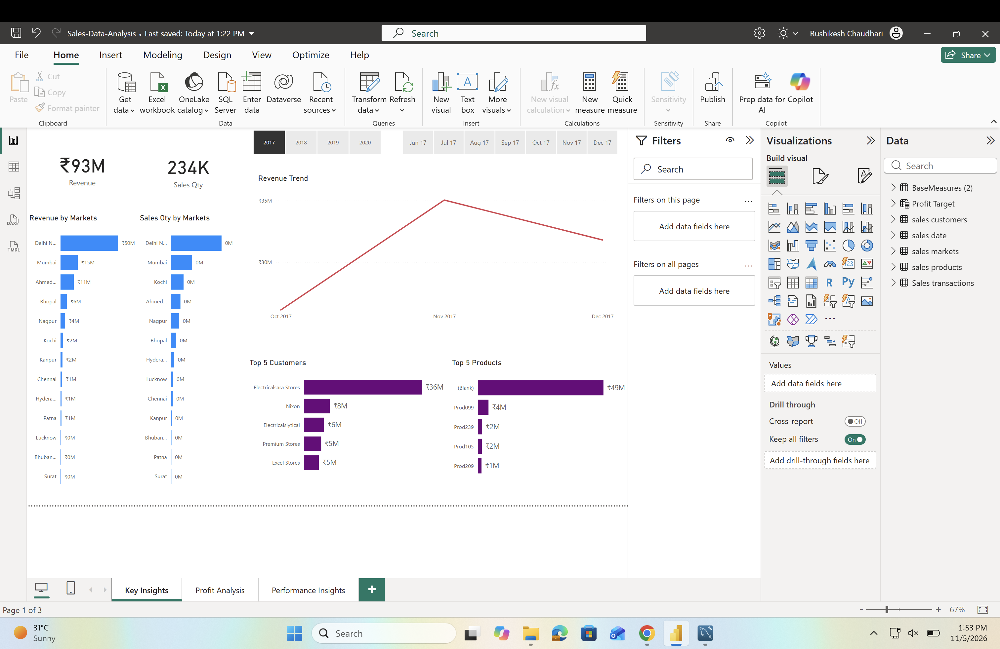
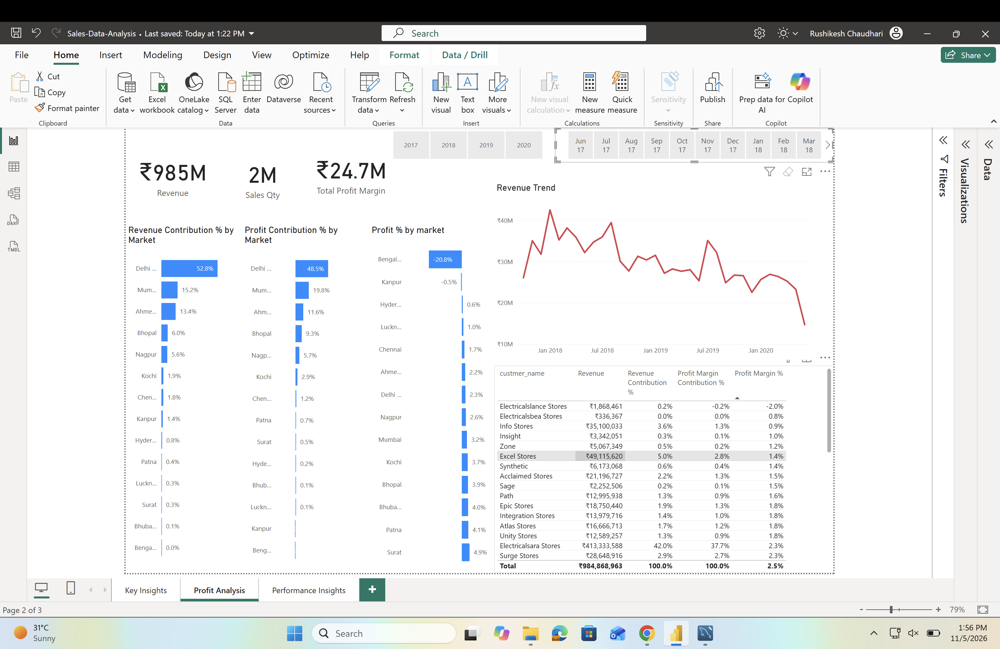
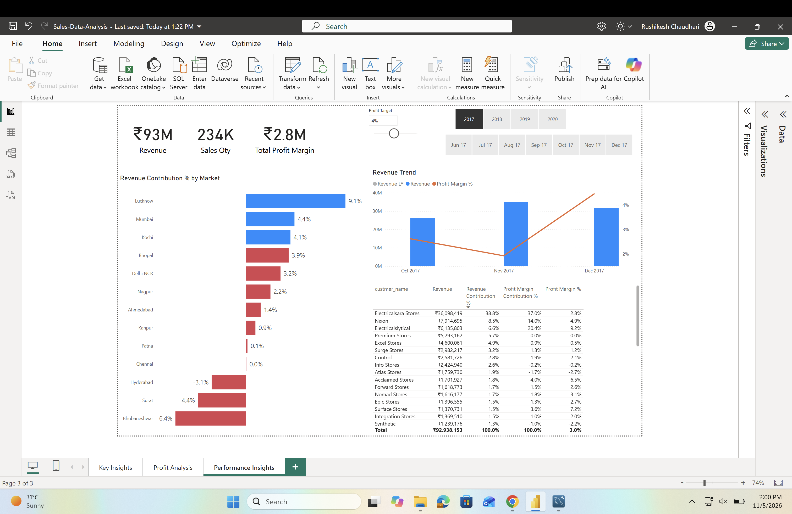

# 📊 SalesVision Analytics
### Sales Data Analysis using SQL & Power BI

**Created by: Rushikesh Chaudhari**

SalesVision Analytics is a sales analysis project that combines SQL queries and an interactive Power BI dashboard to explore revenue, sales quantity, market performance, profit contribution, and customer/product insights.

---

## 👨‍💻 Project Author

**Rushikesh Chaudhari**  
Computer Engineering | SQL | Power BI | Data Analytics

---

## 🎯 Project Objectives

- Analyze sales revenue and sales quantity.
- Identify high-performing and low-performing markets.
- Understand profit contribution and profit margin.
- Find top customers and products.
- Explore sales trends over time.
- Present business insights through Power BI visualizations.

## 🛠️ Tools & Technologies

- **SQL** — data querying and aggregation
- **Microsoft Power BI** — dashboard development and visualization
- **MySQL** — database querying
- **DAX** — measures and calculations

## 📁 Project Files

| File | Description |
|---|---|
| `SalesVision-Analytics.pbix` | Power BI dashboard |
| `db_dump_version_2.sql` | SQL database script |
| `Sales_insight.png` | Key Insights dashboard screenshot |
| `Sales_profit.png` | Profit Analysis dashboard screenshot |
| `sales_performance.png` | Performance Insights dashboard screenshot |

## 📸 Dashboard Preview

### 1. Key Insights


### 2. Profit Analysis


### 3. Performance Insights


## 🔎 SQL Analysis

Example: total revenue

```sql
SELECT SUM(sales_amount) AS Total_Revenue
FROM transactions;
```

Example: revenue by market

```sql
SELECT
    market_code,
    SUM(sales_amount) AS Total_Revenue
FROM transactions
GROUP BY market_code
ORDER BY Total_Revenue DESC;
```

Example: revenue by year

```sql
SELECT
    d.year,
    SUM(t.sales_amount) AS Total_Revenue
FROM transactions AS t
JOIN date AS d
    ON t.order_date = d.date
GROUP BY d.year
ORDER BY d.year;
```

## 💡 Key Dashboard Areas

- Revenue and sales quantity KPIs
- Revenue by market
- Sales quantity by market
- Revenue trends
- Top 5 customers
- Top 5 products
- Profit and contribution analysis
- Performance insights

## 🚀 How to View the Project

1. Download or clone this repository.
2. Open `SalesVision-Analytics.pbix` using **Power BI Desktop**.
3. If prompted, configure the data source or database connection.
4. Use the slicers and visuals to explore the dashboard.

---

## 🙌 Thank You

Thanks for checking out **SalesVision Analytics**!

**Author:** Rushikesh Chaudhari
